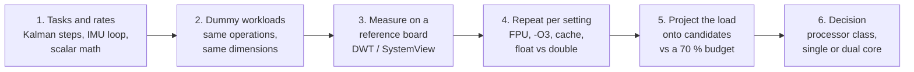
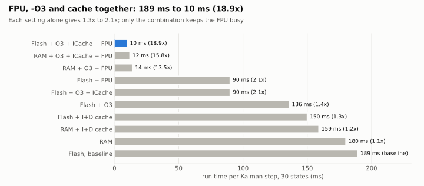
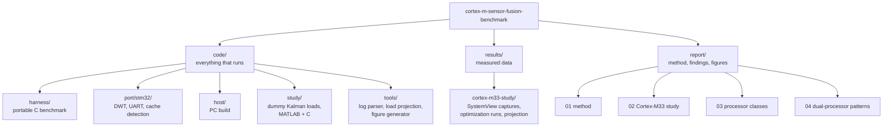

# cortex-m-sensor-fusion-benchmark

**Choosing a processor for a real-time sensor fusion system before the hardware exists:** write dummy workloads that do the same arithmetic as each filter task, time them on a cheap Cortex-M board, and project the load onto candidate processors.



## Key results (Cortex-M33 study)

| | |
| --- | --- |
| **18.9x** | FPU, `-O3` and instruction cache together cut a 30-state Kalman step from 189 ms to 10 ms. Each setting alone gave only 1.3x to 2.1x. |
| **double is the slowest option** | On a single-precision FPU, double ran slower than float with no FPU at all (270 ms vs 189 ms). |
| **284 % load** | The full task set needed almost 3 cores' worth of the 160 MHz Cortex-M33: tuning could not close the gap, a faster class was needed. |
| **Decision** | A dual-core Cortex-M7 + M4 fits the task set at an estimated 48 % on the M7 core, with the M4 free for sensor I/O. |



Full report: [report/02-cortex-m33-study.md](report/02-cortex-m33-study.md)

## Repository map



| Folder | What is inside | Start here |
| --- | --- | --- |
| [`code/`](code/) | Benchmark harness, STM32 port, host build, the study code (MATLAB and C), Python tools | [code/README.md](code/README.md) |
| [`results/`](results/) | Raw measurements as CSV, and the projection tables | [results/README.md](results/README.md) |
| [`report/`](report/) | The method, the study with its figures, processor classes, dual-processor architecture patterns | [report/README.md](report/README.md) |

## Quick start

Check the harness on a PC (timings are not representative of a target):

```bash
cd code/host && make run
```

Run it on an STM32 board: [code/port/stm32/README.md](code/port/stm32/README.md). Then turn the logs into tables and a projection:

```bash
python3 code/tools/parse_log.py logs/O0_soft.txt logs/O3_fpu.txt logs/O3_fpu_cache.txt --out results/<board> --md results/<board>/summary.md
python3 code/tools/project_load.py results/<board>/O3_fpu_cache.csv code/tools/example_taskset.toml
```

Regenerate the report figures from the CSV files:

```bash
python3 code/tools/make_figures.py
```

## What the method shows, and what it does not

It answers early, cheaply and with real numbers: how many cycles each task costs, how much the FPU, caches and compiler settings matter, and whether a candidate processor fits the rate budget with margin.

It does not replace measuring the final firmware: interrupt load, DMA and bus contention, memory placement of the real code and communication stacks all add to the projection. That is what the budget margin is for, and the projection should be repeated on the chosen processor as soon as a board exists.

## Author

Batuhan Kılıçlı, embedded software engineer (defense and avionics).
[LinkedIn](https://linkedin.com/in/batuhankilicli) | [GitHub](https://github.com/batuuhnk)

MIT License.
