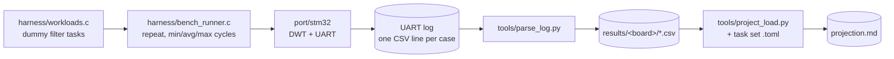

# code/

Everything that runs: the benchmark, its ports, the study code and the tools.

| Folder | Content | Language |
| --- | --- | --- |
| [`harness/`](harness/) | Portable benchmark harness and synthetic workloads: quaternion integration, EKF covariance prediction (9/15/21/30 states), EKF update with Cholesky inversion, matrix and scalar math, float and double. No heap, no OS. Prints one CSV line per case. | C11 |
| [`port/stm32/`](port/stm32/) | STM32 port: DWT cycle counter, UART or `printf` log, cache state detection. [How to run it on a board](port/stm32/README.md). | C |
| [`host/`](host/) | PC build of the harness (`make run`), to check the code and the output format. | C |
| [`study/`](study/) | Code of the Cortex-M33 study: the dummy Kalman filter and optimization loads in MATLAB ([`matlab/`](study/matlab/)) and C, and the FreeRTOS task used to run them under SystemView. | C, MATLAB |
| [`tools/`](tools/) | `parse_log.py` (logs to CSV and comparison table), `project_load.py` (load projection onto candidates), `make_figures.py` (report figures), `example_taskset.toml` | Python |

## Checks

- EKF prediction and update results match NumPy for the same inputs (7 significant digits in single precision).
- Builds with `-Wall -Wextra -Wpedantic -Wconversion -Wshadow` and no warnings on the host, and with Arm GCC 14.2 for Cortex-M33 (soft float and single-precision FPU) and Cortex-M7 (double-precision FPU).
- The STM32 port compiles against the STM32H7 CMSIS device headers.
