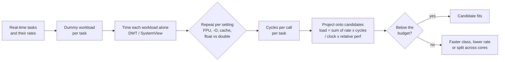

# 1. Method: dummy workloads, isolated timing, load projection

## The problem

The processor of a navigation computer has to be chosen early, often before the filter is written and before any target board exists. Datasheet figures (MHz, CoreMark, "MFLOPS") do not say how long *this* filter takes on *this* core with *this* compiler. Guessing leads to either an oversized, expensive part or a redesign late in the project.

## The idea



1. **Split the system into its real-time tasks** and give each one a rate: IMU integration at the IMU rate, covariance prediction at the filter rate, measurement updates at the aiding rate, and so on.
2. **Write a synthetic workload per task** that does the same operations with the same dimensions: the same matrix sizes, the same number of square roots and divisions, single or double precision. It does not need to compute a correct navigation solution, only the correct amount and kind of arithmetic.
3. **Time each workload on its own** on a cheap reference board with the DWT cycle counter. Isolation makes the cost of each task clear and keeps scheduling and interrupts out of the measurement.
4. **Repeat under each build setting that matters**: FPU off and on, single vs double precision, caches off and on, `-O0` vs `-O2`/`-O3`. This shows where the cycles go and which settings are mandatory.
5. **Project the total load** onto each candidate:

   ```
   load = sum of (rate_hz x cycles_per_call) / (clock_hz x relative_perf)
   ```

   and compare it with a budget (typically 60 to 70 % of the core), leaving the rest for drivers, communication, logging and growth.

## Measurement rules

- **Cycle counter, not a tick timer.** The RTOS tick (often 1 ms) is far too coarse for workloads of a few hundred microseconds. DWT `CYCCNT` counts core clock cycles; its 32-bit wrap is handled by unsigned subtraction.
- **Warm-up run discarded**, then N repetitions; report minimum, average and maximum. The minimum is the cost of the code itself; a large spread points at interrupts, cache misses or flash wait states.
- **One configuration per log.** Every result line carries the core clock, FPU type, optimization level and cache state, so logs cannot be mixed up later.
- **No heap, static buffers.** Memory placement is then fixed by the linker script, and moving the buffers to TCM vs regular SRAM becomes a controlled experiment.
- **Checksums.** Each workload returns a value that is written to a `volatile` sink; otherwise `-O3` can remove the work and report impossible speed-ups.

## Typical findings to look for

| Setting | What usually happens on a Cortex-M with an FPU |
| --- | --- |
| FPU off (soft float) | Every float operation becomes a library call: the matrix workloads slow down by an order of magnitude. |
| Double precision on a single-precision FPU | Doubles fall back to software: often as slow as no FPU at all. Check `__ARM_FP` (`sp` vs `dp` in the log). |
| Code in flash, cache off | Wait states dominate at high clock; enabling the instruction cache / flash accelerator recovers most of it. |
| `-O0` vs `-O2`/`-O3` | Large gains in the matrix loops (register allocation, loop unrolling); smaller in the scalar mix, which is bound by sqrt/div/trig latency. |

The combination of FPU + optimization + cache is not additive: measure the combination you will ship, not only each setting alone.

## From the projection to a decision

- A candidate **fits** when the projected load is below the budget with the shipping build settings.
- If **no single core fits**, look at the per-task table: if one task dominates (usually the covariance prediction at a high filter rate), reduce its rate, split the filter (e.g. error-state with a slower covariance update), or move the high-rate front end to a second core or processor. See [dual-processor patterns](04-dual-processor-patterns.md).
- `relative_perf` is the weakest input. Fill it in from the same harness run on a candidate evaluation board whenever possible; a CoreMark/MHz ratio is only a rough guide for floating-point matrix code.
