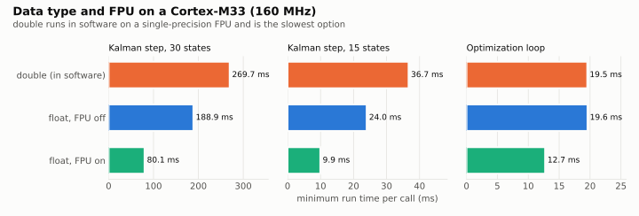
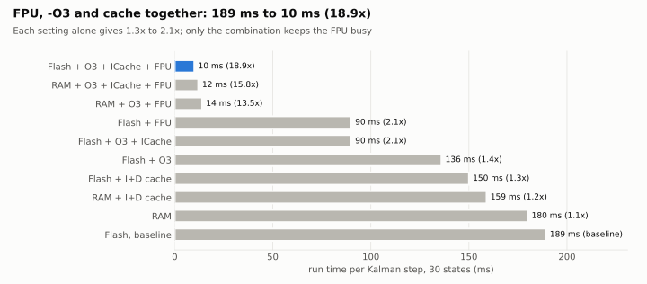
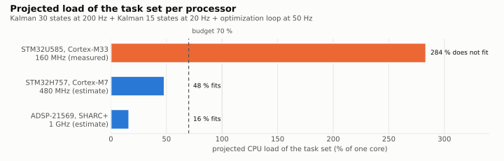

# 2. Study: processor selection for a navigation filter on a Cortex-M33

My first application of the method: the dummy loads, the code that ran them, and the measurements, on an STM32U585 (Cortex-M33). The numbers here were produced **by the study code in [`code/study/`](../code/study/)**, not by the harness in [`code/harness/`](../code/harness/), which was written later as a cleaner, reusable version.

## Question

Can a 160 MHz Cortex-M33 run the filter task set below at the required rates, and if not, which processor class is needed?

| Load | Model | Required rate | Time budget per run |
| --- | --- | ---: | ---: |
| Kalman step, 30 states | `dummy_kf` with S = 30 | 100 Hz | 10 ms |
| Kalman step, 15 states | `dummy_kf` with S = 15 | 10 Hz | 100 ms |
| Optimization loop | `opt_sim` | 25 Hz | 40 ms |

The rates are representative values chosen for this write-up, not the requirements of a specific product.

## Loads

Written first in MATLAB ([`code/study/matlab/`](../code/study/matlab/)), then ported to C ([`code/study/dummy_kf.c`](../code/study/dummy_kf.c)):

- **`dummy_kf`**: one linear Kalman filter step on random data with S states and one scalar measurement, including an S x S matrix inverse (Gauss-Jordan). The inverse and the covariance prediction `A P A^T + Q` dominate the cost (O(S^3)).
- **`opt_sim`**: a small constrained optimization by gradient descent with a quadratic penalty: scalar, branch-heavy code with up to 2000 iterations.

The values are random and the outputs have no physical meaning; only the amount and kind of arithmetic matter.

## Setup

| Item | Value |
| --- | --- |
| MCU | STM32U585, Arm Cortex-M33 at 160 MHz, single-precision FPU |
| RTOS | FreeRTOS (CMSIS-RTOS v2), one task per load ([`freertos_task_example.c`](../code/study/freertos_task_example.c)) |
| Measurement | SEGGER SystemView task statistics (run time per activation, min/max over all activations) |
| Compiler | Arm GCC |

## Results

### 1. Data type and FPU (SystemView captures)

Minimum run time per activation, from [`systemview_captures.csv`](../results/cortex-m33-study/systemview_captures.csv):

| Load | double | float, FPU on | float, FPU off |
| --- | ---: | ---: | ---: |
| Kalman, 30 states | 269.7 ms | 80.1 ms | 188.9 ms |
| Kalman, 15 states | 36.7 ms | 9.9 ms | 24.0 ms |
| Optimization loop | 19.5 ms | 12.7 ms | 19.6 ms |

- **double is the slowest option on this core**, slower even than float without an FPU: the Cortex-M33 FPU is single precision, so every double operation runs in software, with more work per operation than soft float.
- Enabling the FPU cuts the 30-state step by 2.4x. The scalar loop gains less (1.5x): its loop control and branches do not use the FPU.
- The spread between minimum and maximum run time stays under 1 %: the loads are deterministic, and interrupts did not disturb the measurement.

### 2. Optimization combinations, Kalman 30 states

From [`optimization_kf30.csv`](../results/cortex-m33-study/optimization_kf30.csv):

| Configuration | Run time | Speed-up |
| --- | ---: | ---: |
| Code in flash, no FPU, default optimization | 189.3 ms | 1.0x |
| + FPU | 90.0 ms | 2.1x |
| + I+D cache | 150.0 ms | 1.3x |
| + `-O3` | 136.0 ms | 1.4x |
| + `-O3` + instruction cache | 90.0 ms | 2.1x |
| **+ `-O3` + instruction cache + FPU** | **10.0 ms** | **18.9x** |
| Code in RAM + `-O3` + instruction cache + FPU | 12.0 ms | 15.8x |
| Code in RAM + `-O3` + FPU | 14.0 ms | 13.5x |

- **Together the settings give far more than the product of their single gains.** Each one alone gives 1.3x to 2.1x (the product of FPU, `-O3` and cache alone would be about 5.7x); together they give 18.9x. A likely explanation: at the default optimization level the FPU waits on loads and stores to the stack, and with `-O3` but no FPU every operation is a library call, so only the combination keeps the FPU busy.
- Running the code from RAM was slower (12 to 14 ms) than from flash with the instruction cache (10 ms): on this part, cached flash fetches were faster than fetching code from RAM over the bus.
- The FPU-on value differs between the two tables (80 ms in the SystemView capture, 90 ms in the combination test) because they come from separate builds; the conclusions do not depend on the difference.

### 3. Verdict on the Cortex-M33

With the best measured setting the 30-state step takes 10 ms, its whole 10 ms slot, with no time left for anything else. The whole task set needs about **142 %** of the core ([projection.md](../results/cortex-m33-study/projection.md), best measured value for each load), so the requirement cannot be met by tuning: a faster processor class is needed.

### 4. Projection onto candidates

[`projection.md`](../results/cortex-m33-study/projection.md) was produced with `code/tools/project_load.py`:

| Candidate | Clock | Relative speed per cycle | Projected load (budget 70 %) |
| --- | ---: | ---: | ---: |
| STM32U585, Cortex-M33 (measured) | 160 MHz | 1.0 | 142 %, does not fit |
| STM32H757, Cortex-M7 core | 480 MHz | 1.96 (estimate) | 24 %, fits |
| ADSP-21569, SHARC+ DSP | 1 GHz | 2.76 (estimate) | 8 %, fits |

The per-cycle factors are **estimates**, not measurements: about 2x for the Cortex-M7 over the Cortex-M33 on single-precision matrix code (dual-issue pipeline, faster FPU path, TCM and L1 caches), and higher for the SHARC+ DSP (SIMD floating-point units built for matrix and filter code). They were chosen to explore the design space, and should be replaced by measurements on evaluation boards before a final decision.

### 5. Outcome

A dual-core Cortex-M7 + Cortex-M4 microcontroller was selected as the main processor: the projection leaves margin within the 70 % budget on the M7 core alone, the M4 core can take the sensor I/O ([dual-processor patterns](04-dual-processor-patterns.md)), and it keeps a single toolchain and a familiar ecosystem. A floating-point DSP stayed on the list as the option for larger filters or higher rates.

## Lessons

1. Look at the whole task set: the 30-state step alone just fits its own slot on paper, while all three loads together need about 1.4x the core.
2. Check the FPU precision of the core before choosing `double`: on a single-precision FPU it costs more than having no FPU.
3. Measure the combination you will ship. FPU, `-O3` and caches have to be enabled together to see the real cost.
4. Keep the projection's assumptions visible and replace estimates with measurements as soon as boards are available.

## Files

| Path | Content |
| --- | --- |
| `code/study/matlab/dummy_kf.m`, `opt_sim.m` | MATLAB versions of the loads |
| `code/study/dummy_kf.c`, `dummy_kf.h` | C port used on the target (S and the data type set at compile time) |
| `code/study/freertos_task_example.c` | FreeRTOS task and SystemView stack watermark hook used to run each load |
| `results/cortex-m33-study/systemview_captures.csv` | SystemView run-time statistics per load, data type and FPU setting |
| `results/cortex-m33-study/optimization_kf30.csv` | Optimization combinations for the 30-state load |
| `results/cortex-m33-study/best_measured.csv`, `taskset_study.toml`, `projection.md` | Input and output of the load projection |

The C port in this repository fixes a copy bug in the matrix inverse of the measured version (the matrix was not copied into the augmented working array). For a non-singular matrix the fixed code performs the same operations, so the run times are expected to be equivalent.
