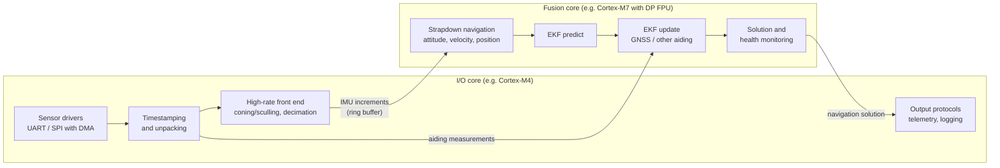

# 4. Dual-processor and dual-core architecture patterns

When one core cannot run the whole task set within budget, or when hard real-time sensor handling has to be isolated from the filter, the work is split across two cores (one dual-core chip) or two processors. This page describes the general patterns; it is not the design of any specific product.

## The split

| Core | Owns | Why |
| --- | --- | --- |
| I/O core | Every interrupt and DMA channel of the sensors, sample timestamping, the high-rate front end, output protocols | Keeps interrupt load and bus traffic away from the filter; the high-rate loop has the tightest latency and the simplest math |
| Fusion core | Navigation equations and the filter, at a lower and steady rate | Deterministic, mostly floating-point load; the benchmark of this repository is about this core |

Running the high-rate integration on the I/O core and handing over *increments* (delta angle and delta velocity over N samples) reduces the inter-core traffic by a factor of N and lets the filter run at its own rate.

## Inter-core communication options

| Mechanism | Use | Notes |
| --- | --- | --- |
| Shared SRAM + lock-free ring buffer | Streaming sensor data (one producer, one consumer) | No locks needed with single producer/consumer; place it in a non-cacheable region or clean/invalidate the cache lines explicitly |
| Hardware semaphores (e.g. STM32 HSEM) | Ownership of shared resources, "data ready" notification with interrupt | Cheap and deterministic; keep critical sections short |
| Mailbox / message queue on shared memory | Commands, configuration, status | Fixed-size messages with a sequence number and CRC make loss and corruption visible |
| Serial link between two chips (QSPI, SPI, UART) | Two separate processors | Define a framed protocol with sequence numbers, CRC and a heartbeat; size the link for the worst-case data rate with margin |

## Memory placement rules

- **Critical code and data in TCM** where available (the filter loops, its matrices, the ISR of the timestamping): no cache effects, single-cycle access.
- **DMA buffers** in a region the DMA can reach, and either non-cacheable or handled with explicit cache maintenance (clean before DMA reads, invalidate after DMA writes), aligned to cache lines.
- **Shared buffers** between cores in one clearly defined region, configured identically in both MPUs, with a written ownership rule per buffer.
- **No dynamic allocation** after start-up on either core.

## Timing budget

Time stamps are taken as close to the sample as possible (sensor data-ready interrupt or the sensor's own timestamp), on the I/O core, and travel with the data. The fusion core computes its time step from these timestamps, not from when it happened to run. This removes scheduling jitter on either core from the filter's view of time.

Each stage then gets a latency budget (acquisition, front end, transfer, filter step, output), and the sum is checked against the end-to-end latency requirement. The per-task cycle counts from the benchmark fill in the filter part of this budget.

## When a single core is enough

A dual-core or dual-processor design costs two firmware images, a shared-memory contract and harder debugging. If the projected load of the whole task set on one core is below budget with margin, a single core with a clear task priority scheme (sensor tasks above the filter, outputs lowest) is the simpler and safer choice.
