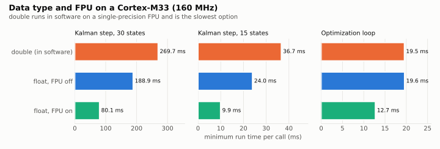
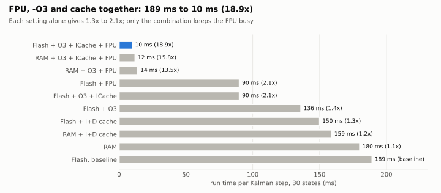
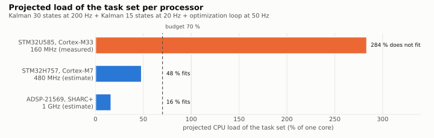

# report/

| # | Document | Read it for |
| --- | --- | --- |
| 1 | [Method](01-method.md) | How dummy workloads, isolated timing and load projection work, measurement rules, typical findings |
| 2 | [Cortex-M33 study](02-cortex-m33-study.md) | The full study: loads, setup, measurements, figures, projection, decision and lessons |
| 3 | [Processor classes](03-processor-classes.md) | Selection criteria and processor classes (Cortex-M, dual-core, crossover, Cortex-R, DSP) |
| 4 | [Dual-processor patterns](04-dual-processor-patterns.md) | Splitting I/O and fusion across two cores, inter-core communication, memory placement, timing budget |

Figures in [`figures/`](figures/) are generated from the CSV files in [`../results/`](../results/) by `code/tools/make_figures.py`.

| Figure | Shows |
| --- | --- |
|  | Data type and FPU: double vs float with and without FPU, per load |
|  | FPU, `-O3`, cache and memory placement combinations for the 30-state load |
|  | Projected load of the task set per candidate processor against the 70 % budget |
